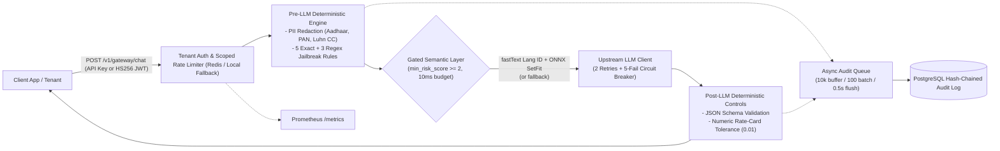

# Deterministic AI Governance Gateway

A production-oriented **FastAPI reverse proxy** for enterprise LLM traffic that enforces deterministic pre-LLM and post-LLM safety controls, gated semantic risk classification, tenant-scoped authentication, Redis rate limiting, upstream circuit breaking, and tamper-evident PostgreSQL audit logging.

---

## Architecture



---

## Verified System Capabilities & Configuration

All figures below reflect the actual implementation in `app/config.py`, `policies/default.yaml`, `app/engine/`, `app/services/`, and `tests/`:

### 1. Pre-LLM & Post-LLM Deterministic Controls
* **PII Redaction (`app/engine/pii.py`)**: Detects and redacts **3 identifier classes** using policy regex rules—Indian **Aadhaar**, **PAN**, and **Credit Cards** (validated via `luhn_checksum_ok` before masking to minimize false positives).
* **Jailbreak Filtering (`app/engine/jailbreak.py`)**: Enforces **5 exact deny-list phrases** and **3 case-insensitive regex deny patterns** in `policies/default.yaml` (`version: 2026.03.0`).
* **Post-LLM Verification (`schema_validator.py`, `math_validator.py`)**: Enforces response conformance via **JSON Schema (`jsonschema 4.25.0`)** and numeric rate-card assertions (`home_loan: 8.35`, `personal_loan: 13.99`, `default: 10.0`) within a `0.01` numeric tolerance.

### 2. Latency-Budgeted Semantic Layer
* **Execution Mode (`app/services/semantic.py`)**: `sync_gated` execution only triggers the ML classifier when risk heuristic score meets `min_risk_score >= 2`, protecting latency on clean traffic.
* **Language Allowlist & Models**: Supports **12 languages** (`en`, `hi`, `mr`, `bn`, `ta`, `te`, `kn`, `ml`, `gu`, `pa`, `ur`, `hinglish`) via fastText (`lid.176.ftz` with script fallback) and ONNX Runtime (`semantic_setfit_int8.onnx` with lexical fallback).
* **Strict Budget**: Default `timeout_ms: 10`, `min_confidence: 0.80`, and configurable `fail_mode` (`allow` or `block`).

### 3. Auth, Resilience & Observability
* **Authentication (`app/services/auth.py`)**: Supports `api_key`, `jwt` (`HS256` with `iss` and `aud` validation), or `either` mode, enforcing per-request `tenant_id` isolation.
* **Traffic Protection (`rate_limit.py`, `circuit_breaker.py`)**: Default `120` requests/minute Redis rate limiter (with in-memory local fallback), upstream timeout `20.0s`, `2` retries with `0.3s` backoff, and circuit breaker tripping after `5` consecutive failures (`30s` recovery window).
* **Audit Logging & Metrics (`audit.py`, `observability.py`)**: Asynchronous queue (`10,000` max capacity, `100`-record batches flushed every `0.5s`) writing hash-chained audit logs to PostgreSQL, plus live Prometheus instrumentation.

---

## API Endpoints

| Method | Endpoint | Purpose |
| :--- | :--- | :--- |
| `POST` | `/v1/gateway/chat` | Governed LLM proxy endpoint (pre-checks, semantic gate, upstream call, post-checks) |
| `GET` | `/v1/governance/report` | Query tenant-scoped compliance & audit report (`tenant_id`, `from_ts`, `to_ts`) |
| `GET` | `/health` | Liveness probe |
| `GET` | `/ready` | Readiness probe |
| `GET` | `/metrics` | Prometheus metrics export |

---

## Tech Stack

* **API & Runtime**: Python 3.12, FastAPI `0.116.1`, Uvicorn `0.35.0`, Pydantic `2.12.5`, HTTPX `0.28.1`
* **ML & NLP**: ONNX Runtime `1.24.4`, Tokenizers `0.21.4`, fastText `0.9.2`, NumPy `2.3.2`
* **Data & Infra**: Redis `6.4.0`, PostgreSQL (`psycopg[binary] 3.2.13`), Docker & Docker Compose
* **Security & Monitoring**: PyJWT `2.10.1`, PyYAML `6.0.2`, jsonschema `4.25.0`, Prometheus Client `0.22.1`

---

## Setup & Verification

### Run via Docker Compose
```bash
cp .env.example .env
docker compose up --build
```
Gateway listens on `http://localhost:8000`. See [models/README.md](models/README.md) for optional local ONNX/fastText model placement (lexical and script-based fallbacks activate automatically when model binaries are absent).

### Policy Signing
```bash
python3 scripts/sign_policy.py policies/default.yaml
```

### Automated Unit Tests (`pytest 8.4.1`)
The test suite currently includes **14 unit tests** across 3 files:
* `tests/test_engine.py` (**6 tests**): PAN/Aadhaar redaction, literal/obfuscated/regex jailbreak blocking, numeric rule validation
* `tests/test_policy_auth.py` (**3 tests**): API key auth, JWT auth, HMAC policy signature verification
* `tests/test_semantic.py` (**5 tests**): Override signal scoring, policy config binding, fallback blocking, async gating, low-risk gate skipping

```bash
PYTHONPATH=. pytest -q
```

### Benchmark Harness (`scripts/run_benchmark.py`)
Runs an **in-process ASGI load test** (`httpx.ASGITransport`) defaulting to **2,000 requests** (`--concurrency 100` CLI default) across **3 profiles** (`default`, `semantic_off`, `timeout_fail_closed`) and **4 scenario weights** (`70%` safe, `15%` PII-safe, `10%` jailbreak, `5%` semantic attack) against a simulated `15ms` upstream LLM mock and bypassed rate limiter:

```bash
PYTHONPATH=. python3 scripts/run_benchmark.py --requests 2000 --concurrency 20 --profile default
```

> **Measured Local Run Results:** *(Run the command above in your local environment and paste the resulting `p95`, `p99`, `throughput_rps`, `attack_detection_rate`, and `false_positive_rate` JSON output here.)*
